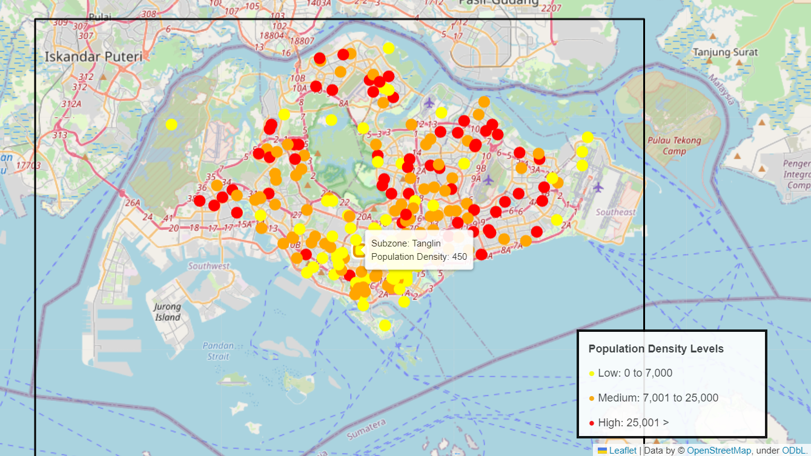
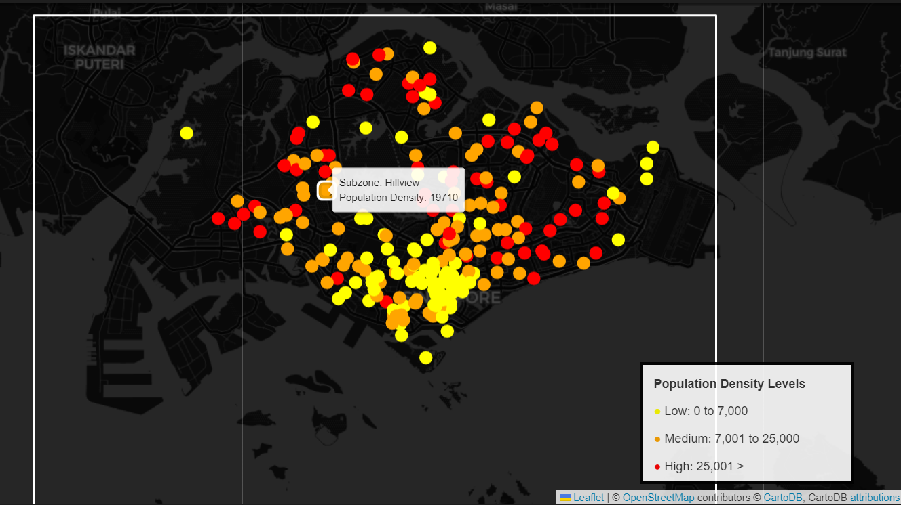

# Singapore Heat Factors Analysis: Vending Machine Site Selection
# Republic Polytechnic

**Project By: Brunda Varshini Katapalli** (group of 4 members)

A Diploma in IT Final Year Project (2023) for an industry partner. The wider project aimed to **develop a footfall sensor** (Raspberry Pi camera) that detects foot traffic for vending machines, and to combine it with environmental and local data (land surface temperature, weather, population, vegetation cover, crime rates and hawker centres), all stored on AWS and shown on a user-friendly website. Based on this data, the client decides **where to sell his sugarcane drinks**: The hottest and busiest parts of Singapore, where people want a cold drink.

**This repository contains only my part**: 2 of the factors that influence how hot an area is, **vegetation cover** and **population**, plus the website that presented them. The rest of the team worked on the footfall sensor, land surface temperature, weather, crime and hawker centre data.

## Why these 2 factors?
- **Vegetation cover:** Less greenery generally means a hotter area, because plants cool their surroundings.
- **Population:** More residents means more potential customers, and dense built-up areas tend to trap heat.

Areas with low vegetation and high population are the strongest candidates for a vending machine.

## What I built

### 1. Population map (Python)
Reads resident population per subzone from [SingStat](https://www.singstat.gov.sg/find-data/search-by-theme/population/geographic-distribution/latest-data) (2022, summarised with an Excel pivot table, in `data/`), finds each subzone's coordinates with **OpenStreetMap's Nominatim geocoder** and plots colour-coded markers **(Low / Medium / High)** on an interactive **Folium** map.

| Normal view | Night view |
|---|---|
|  |  |

3 versions are included: `population_density_normal.py`, `population_density_night.py` and `population_density_heatmap.py`.

### 2. Vegetation cover (Google Earth Engine, JavaScript)
`vegetation-cover/VegetationCover.js` processes **Landsat 8** imagery from 2015 to 2022 over Singapore:
- Calculates **NDVI** (a vegetation index) for every image,
- Masks out water bodies using **MNDWI**,
- Draws a colour-coded vegetation map with a legend,
- Plots a line chart of the average NDVI over the 7 years.

### 3. Website (HTML, CSS, JavaScript)
`website/` has 3 pages (Home, Population Density, Vegetation Cover) that present the results for non-technical users. The vegetation page embeds the published Earth Engine app.

### 4. Cloud setup (not included here)
I set up an AWS EC2 server with a MySQL database for a teammate's footfall data and hosted the pages on S3.

## Run it

**Population maps**
```
pip install pandas folium geopy
python population-density/population_density_normal.py
```
It saves `population_density_normal.html`. Open it in a browser. The script geocodes about 230 subzones one by one, so it takes a few minutes (Nominatim limits request rates).

**Vegetation cover:** paste `vegetation-cover/VegetationCover.js` into the [Earth Engine Code Editor](https://code.earthengine.google.com/) and click Run (a free Earth Engine account is needed).

**Website:** open `website/HomePage.html` in a browser.

## Notes and limitations
- The values in `data/PivotTable_PopDen.csv` (`Sum of Pop`) are **resident population counts per subzone**, not people per square kilometre. The maps and the Low/Medium/High bands (up to 7,000 / up to 25,000 / above) use these counts. The code and website call this "population density".
- 97 of the 332 subzones have zero residents (industrial areas, reservoirs, the airport) and are left off the map.
- **Landsat 8 limitation:** each pixel covers a large area, so some of neighbouring Malaysia can appear on the vegetation map. The line chart only averages inside Singapore's boundary.
- Subzone locations are single points found by geocoding, not the actual subzone boundaries.

## Tech
Python (pandas, Folium, geopy), JavaScript, Google Earth Engine, Landsat 8, OpenStreetMap / Nominatim, HTML/CSS, AWS (EC2, S3, MySQL).

## Credits
Population Data: Singapore Department of Statistics (SingStat). Satellite imagery: USGS Landsat 8 via Google Earth Engine. Map data: © OpenStreetMap contributors.
